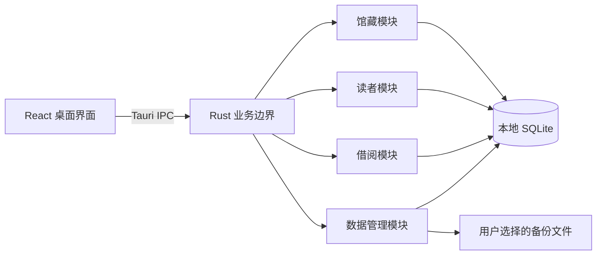

# 整体架构

Rust + Tauri + React 基础框架及 4 个业务模块已实现并集成，验证结果见[交付验证](verification.md)。

## 技术栈

| 范围 | 选择 | 约束或理由 |
|---|---|---|
| 桌面容器 | Tauri 2 | 本地 WebView 展示界面，Rust 处理业务与系统访问 |
| 后端 | Rust stable | 负责校验、事务、数据访问及备份恢复；工具链固定在 rust-toolchain.toml |
| 前端 | React + TypeScript + Vite | 中文桌面界面，TypeScript 开启严格检查；初始化时锁定相互兼容的版本 |
| 界面 | 原生 CSS + 可复用 React 表单、表格、对话框 | 规模较小，不引入大型组件或全局状态框架 |
| 本地数据 | SQLite + rusqlite | 使用 bundled SQLite 和备份能力，统一由 Rust 访问 |
| 原生能力 | Tauri 对话框、单实例能力 | 文件选择用于备份恢复，同一数据目录仅允许一个应用实例 |

已建立 package-lock.json 与 Cargo.lock，Rust 固定为 1.95.0；当前锁定 React 19.3.1、Vite 7.3.7、TypeScript 5.9.3、Tauri Rust 2.12.5 / JS 2.12.4、rusqlite 0.37.0。

## 整体架构

应用打包前端静态资源，通过 Tauri command 传递结构化请求、结果与错误；该通信方式见 [Tauri 官方说明](https://v2.tauri.app/develop/calling-rust/)。运行时不启动 HTTP 服务，不依赖外部 API 或远程资源。Rust 后端是业务规则的最终执行方，React 不直接执行 SQL 或读写数据库文件。

### 桌面界面

采用左侧导航与右侧内容区，初始窗口 1280 × 800、最小 1024 × 680，窄窗口允许表格横向滚动。使用清晰的中文标签、可见焦点、文字状态及颜色辅助区分；表单支持键盘操作。

| 导航 | 主要内容 | 对应功能 |
|---|---|---|
| 图书管理 | 搜索和状态筛选、馆藏表格、录入与编辑侧栏 | F01 |
| 读者管理 | 搜索、读者表格、档案侧栏 | F02 |
| 借还工作台 | 借书／还书两个页签；选择读者和实体书后确认办理 | F03、F04 |
| 借阅记录 | 全部／在借／逾期／已归还筛选及详情 | F05 |
| 数据管理 | 手动备份、选择恢复文件、校验摘要与恢复确认 | F06 |

进入应用默认显示图书管理；详情、借书和还书提供关联跳转，返回时保留来源页面的查询条件。每个列表均设计加载、空数据、无匹配和失败重试状态。提交期间禁用重复操作，只有 Rust 确认成功后才更新界面数据；失败保留用户输入并显示原因。

## 架构原则

- 依赖方向为界面 → IPC → 业务 → 持久化，模块职责见[项目索引](project.md#模块)。借阅操作在同一数据库事务中读取馆藏和读者状态并完成校验；禁止先在前端判断可借后直接写入结果。
- 数据库位于操作系统的应用数据目录，独立于安装目录；首次启动创建空库并执行带版本的迁移。迁移失败停止业务写入并显示错误，不能重置已有数据。升级已有库前保留一致性快照。
- 数据访问启用外键约束，所有写入事务化并协调访问。借阅唯一性、馆藏编号和读者编号唯一性由数据库约束兜底。备份、恢复及迁移与正常操作互斥；启动执行数据库完整性与外键检查，失败时显示原生中文错误提示并停止业务操作。
- 正常关闭、重启及重新安装应用资源不应主动删除业务数据。数据库、迁移失败及写入失败不能降级为内存数据后宣称保存成功。
- IPC 仅开放本应用所需命令，原生插件按最小权限配置；不接受前端任意 SQL 或 shell 命令。文件操作限定于应用数据目录与本次原生对话框选定的位置，恢复文件按不可信输入校验。
- 同步数据库和备份 I/O 不阻塞界面线程。备份恢复期间展示进行中状态，阻止新的业务请求；恢复成功后卸载其他已访问页面、清除旧筛选与预选对象，保留数据管理页的安全备份结果并重新读取。

## 共享数据关系

各实体使用稳定内部 ID 关联，展示编号独立于内部 ID。首版每条馆藏记录代表一本可单独借还的实体书，同 ISBN 的多个副本可以共享书目信息文本，但各自拥有唯一馆藏编号，不建立额外书目实体。

| 实体 | 字段语义与关系 | 关键约束 |
|---|---|---|
| 图书实体副本 | 馆藏编号、书名、作者、可选 ISBN／出版社／分类／位置、启用状态、创建及更新时间 | 馆藏编号唯一；ISBN 可重复；是否借出由有效借阅派生 |
| 读者 | 读者编号、姓名、可选联系电话／备注、启用状态、创建及更新时间 | 读者编号唯一；姓名与联系电话可重复 |
| 借阅记录 | 关联读者及图书 ID、借出时间、应还日期、可空归还时间及归还时本地日期；保存借出时的读者编号／姓名、馆藏编号／书名快照 | 同一图书最多一条未归还记录，归还记录保留；归还时间与归还本地日期同时为空或同时存在；快照用于历史展示 |
| 数据库版本 | SQLite application_id 与 user_version | 供启动迁移和恢复兼容性判断，不作为业务功能单独展示 |

不单独保存可借数量、在借数量或逾期标记，按图书和借阅记录计算，避免借还后计数不同步。图书和读者采用停用保留历史，首版不提供物理删除。

发生时间保存为 UTC 时间戳，应还日期及归还时本地日期保存为无时区的日历日期；后者用于稳定判断历史逾期归还。借期、逾期与归还分类的口径统一见[借阅模块](modules/circulation.md#核心业务规则)。

## 全局代码规范

- 用户可见文本为简体中文，标识符与数据库名称采用英文；跨 IPC 的结构化数据统一 camelCase，内部命名遵循 Rust／TypeScript 惯例。
- Rust 验证所有 IPC 输入；前端校验只提供即时反馈。字符串去除首尾空白，必填项拒绝空白值，长度和唯一性按各功能规格执行。
- IPC 错误包含稳定错误类别、中文说明及可选字段定位；至少区分输入无效、数据不存在、业务冲突、存储失败和维护中。界面不直接展示数据库语句或堆栈。
- 金融、登录及网络能力均不在首版范围；不为其预建空模块。日志不记录完整读者电话、备注或数据库内容。
- 复用表格、筛选栏、字段错误与确认对话框；业务事实来自后端，页面切换、提交及恢复后按需重新查询。

## 验证入口

| 入口 | 用途 |
|---|---|
| `npm run tauri dev` | 启动包含 Rust 后端的开发客户端 |
| `npm run build` | TypeScript 严格检查和前端生产构建 |
| `npm test` | 前端交互、IPC 边界、恢复后页面状态和分页回归测试 |
| `cargo fmt --manifest-path src-tauri/Cargo.toml --check` | Rust 格式检查 |
| `cargo test --manifest-path src-tauri/Cargo.toml` | SQLite、业务事务、并发、备份恢复和跨模块测试 |
| `cargo clippy --manifest-path src-tauri/Cargo.toml --all-targets -- -D warnings` | Rust 严格静态检查 |
| `npm run tauri build` | 生成正式版本地桌面客户端 |

自动检查和实际桌面操作结果集中记录在[交付验证](verification.md)。当前验证平台为 macOS Apple Silicon；Windows、Linux 未构建或验证。macOS `.app` 为本地交付产物，未进行 Apple 公证。

调试构建支持 `QINGHE_TEST_DATA_DIR` 指定隔离数据目录，用于原生流程与异常数据库测试；正式构建不读取该变量。正常运行的数据库位于系统应用数据目录，不打包任何示例业务数据。

## 技术参考

以上为项目设计选择；框架与数据库能力依据 [Tauri 架构](https://v2.tauri.app/concept/architecture/)、[前端调用 Rust](https://v2.tauri.app/develop/calling-rust/) 和 [rusqlite 备份 API](https://docs.rs/rusqlite/latest/rusqlite/backup/index.html)。
