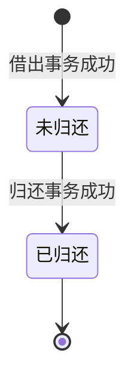

# 借阅模块

项目见[项目概览](../project.md)，全局约束见[整体架构](../architecture.md)。

## 职责与边界

处理借出、归还、借阅检索和只读统计，统一维护借阅生命周期。馆藏和读者档案分别由其所属模块维护。

## 对外能力与功能

| 能力 | 功能规格 | 状态 |
|---|---|---|
| 校验并登记借出 | [借书登记](../features/circulation/checkout.md) | 已实现 |
| 办理归还并释放实体书 | [还书登记](../features/circulation/return.md) | 已实现 |
| 查询当前借阅、逾期和归还历史 | [借阅查询](../features/circulation/loan-query.md) | 已实现 |
| 概况、7 天趋势、热门馆藏及分类分布 | [借阅统计](../features/circulation/statistics.md) | 已实现 |

## 核心业务规则

以下借期和上限采用[首版业务选择](../project.md#首版业务选择)。

- 每次办理一本实体书；借出对象必须为启用读者和可借图书。每位读者最多同时借 5 本，逾期未还也占用名额；达到上限时禁止新增借阅。
- 默认借期为 30 个自然日，应还日期为借出时系统本地日期加 30 天。例如 2026-10-31 借出，应还日期为 2026-11-30；首版不允许修改借出时间、借期或应还日期。
- 当前借阅分为未归还与已归还。逾期是未归还记录在系统本地日期晚于应还日期时的派生状态；到期当天不算逾期。历史记录另按实际归还日判断是否逾期归还。
- 归还保存后端生成的实际时间和归还时本地日期，不补录过去日期；历史逾期归还按已保存的归还本地日期判定，不因后来切换时区而变化。停用读者可归还。重复归还不改变原归还时间，也不再次修改任何状态。
- 存在逾期记录时提示管理员，仍按借阅上限允许借书；不计算罚款，不自动停用读者。
- 每本实体书至多存在一条未归还借阅。借出校验与新增记录在同一事务完成；归还及其结果也必须原子完成。
- 借出时保存读者编号／姓名和馆藏编号／书名快照供历史展示，关联 ID 用于当前读者和图书查询。历史页明确注明字段为“借出时信息”，编辑档案不会改变历史快照。
- 设备本地日期用于日历判断；日期变更、页面重新聚焦和刷新时重新计算逾期，避免打开客户端跨午夜后仍显示旧状态。系统时钟或时区调整可能改变当前逾期分类，历史应还日期不回写。

## 依赖与接口约束

| 依赖或调用方 | 协作内容 | 接口与行为约束 |
|---|---|---|
| [馆藏模块](catalog.md) | 读取启用状态与实体资料，关联当前借阅 | 借出与停用冲突时仅允许一种操作成功，禁止读者借到已停用书 |
| [读者模块](readers.md) | 选择读者、校验启用状态 | 每次提交重新读取状态，在借数量以未归还记录计算 |
| [数据管理模块](data.md) | 完整保存、恢复借阅与关系 | 恢复须保留借阅唯一性、外键和历史快照 |

## 状态与一致性

逾期是未归还状态上的查询条件，不单独持久化。归还后再次借出创建新记录，不复用旧记录。前端按钮禁用只改善交互，数据库约束和后端事务必须独立保证一致性。

## 验证情况

借书、还书和借阅查询均已在模块 worktree 实现，通过前端构建、模拟 IPC 界面测试及 Rust 事务、并发和日期边界测试；已补充同一目标重复导航及归还导致末页失效的界面回归测试；具体覆盖与验收条目见各功能规格。主分支集成及原生桌面技术验证已完成，见[交付验证](../verification.md)。新增统计已通过独立查询核对与只读数据检查，详细口径及结果见[借阅统计](../features/circulation/statistics.md)。借阅统计已获用户确认，其余功能维持各规格中的验收记录。
